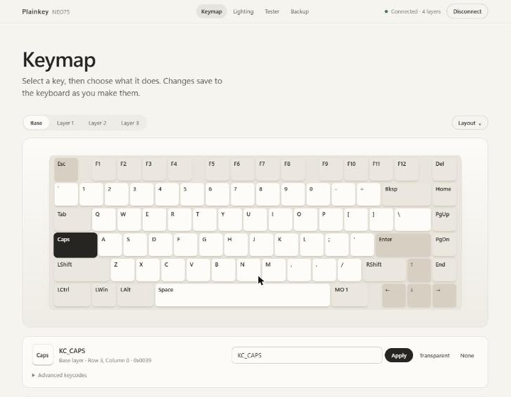

# Plainkey

A minimal web configurator for VIA-compatible keyboards.

Plainkey edits the keymap stored on your keyboard through the open VIA protocol: the same
raw-HID messages the [VIA app](https://github.com/the-via/app) sends to QMK firmware. It works
with your keyboard's existing firmware, so nothing is flashed and features such as wireless
modes stay as they are.



## Features

- **Keymap:** pick a layer, click a key, and choose from the palette, or type any QMK keycode:
  `KC_A`, `LCTL(KC_C)`, `LT(1,KC_SPC)`, `MT(MOD_LSFT,KC_Z)`, `MO(2)`, `DF(2)`, `0x5221`.
  Search across every key, hold modifiers, undo with Ctrl+Z, and move around with the arrow keys.
- **Layout options:** split Backspace, ISO Enter, alternate bottom rows, or whatever the
  definition declares.
- **Keyboard-specific keys:** custom keycodes from the definition, for example Bluetooth
  channels, 2.4G, USB and battery check on the NEO75.
- **Lighting:** brightness, effect, speed and colour, when the firmware accepts VIA lighting
  commands.
- **Key tester:** shows switch presses live.
- **Backup:** download, restore and reset the keymap.
- Light and dark themes. No build step and no dependencies.

## Quick start

Requires [Node.js](https://nodejs.org) 18 or newer and **Chrome or Edge**. WebHID isn't available
in Firefox or Safari.

```sh
git clone https://github.com/ukarpoh/Plainkey.git
cd Plainkey
npm start
```

Open <http://localhost:5173>, connect the keyboard with a **USB cable** (VIA commands don't
travel over Bluetooth or 2.4G), close any other configurator, and click **Connect**.

Download a backup from the **Backup** tab before your first edit.

## Other keyboards

Plainkey loads `definitions/neo75.json` by default. To use another keyboard, choose
**Use another definition** in the footer and pick its VIA definition JSON. Many are published in
[the-via/keyboards](https://github.com/the-via/keyboards). The keyboard must run firmware with
VIA enabled.

Supported: keymaps on VIA protocol 9 and newer (QMK keycode ranges for protocol 12+, legacy
ranges below that), KLE layouts with layout options, and the QMK lighting channels. Not yet
supported: macros, rotary encoders, and custom definition menus.

## Development

```sh
npm test   # protocol tests against a simulated keyboard, plus keycode and layout tests
```

| File | Purpose |
|---|---|
| `src/via.js` | VIA protocol over WebHID (32-byte reports, usage page `0xFF60`) |
| `src/keycodes.js` | QMK keycode encoding and parsing |
| `src/layout.js` | KLE layout parsing and layout-option bit packing |
| `src/app.js` | Interface |
| `serve.mjs` | Zero-dependency static server (WebHID needs `localhost` or HTTPS) |

## Disclaimer

Plainkey is an independent project. It isn't affiliated with or endorsed by VIA, QMK, or any
keyboard maker. Product names belong to their owners. Changes are written straight to your
keyboard, so keep a backup.

## License

[MIT](LICENSE)
